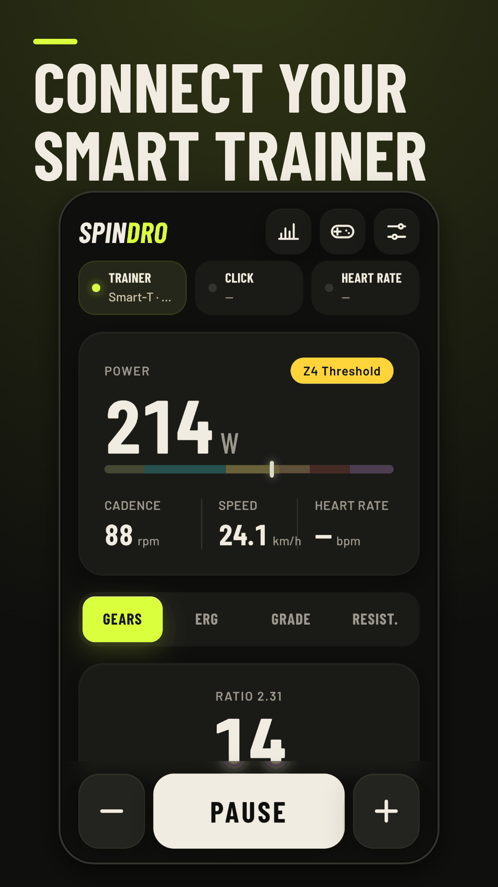
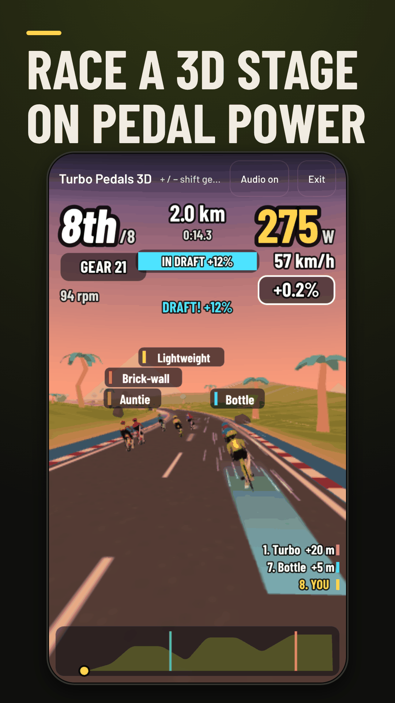
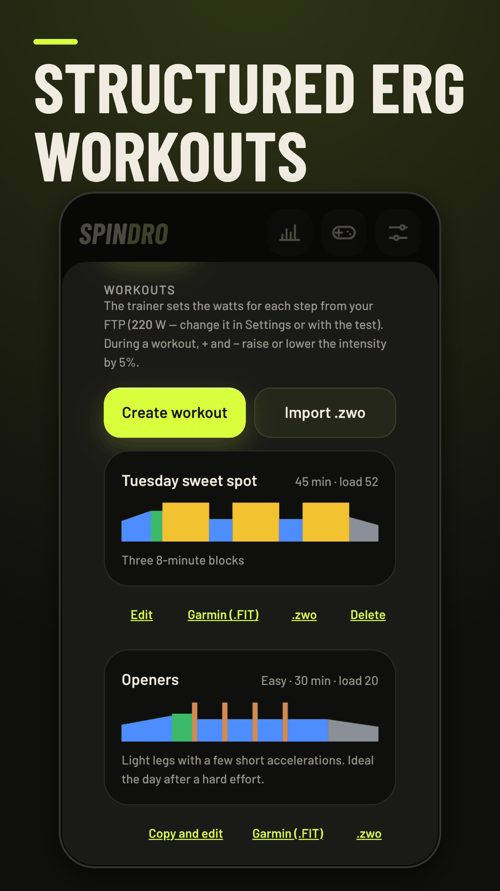
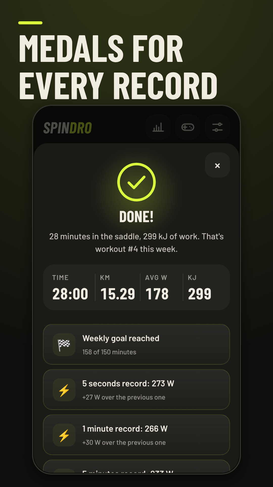

# Spindro: Smart Trainer Cycling

**Free, open-source indoor cycling app for smart trainers. No subscription, no account needed.**

Spindro runs in your browser (Android, PC, Mac) or as an Android app. It connects to your trainer over Bluetooth, gives you virtual gears, structured workouts and games driven by your real power, and can turn your phone into a sensor so the ride lands on your watch.

<p>




</p>

- **Web app:** https://mta-world.com (Chrome or Edge)
- **Android APK:** https://mta-world.com/app/spindro.apk

## What it does

- **Virtual gears** (24 ratios) on any controllable trainer, like a Zwift Cog setup, plus ERG, slope and resistance modes. Optional auto-shift keeps your cadence.
- **Zwift Click, Play and Ride** as shifters and as a full remote: you can drive the whole app from the handlebar.
- **Workouts:** 34 structured workouts, 4 multi-week plans, a ramp FTP test, a block editor, `.zwo` import, export to `.zwo` and Garmin workout `.fit`.
- **Games in 3D** driven by your watts: a stage race with drafting and climbs that load the trainer, a horde shooter, a peloton builder.
- **Routes:** load a GPX and the slope follows the course. **Video rides:** a YouTube video or your own file plays at your speed.
- **Your watch as the head unit** (Android app): the phone broadcasts power, cadence and speed as a Bluetooth sensor.
- **Records and history**, monthly challenges, a share card, `.fit` export with GPS for Garmin Connect, optional Strava upload.
- **5 languages:** English, Italian, French, Spanish, German. Voice coach included.
- **Private by default:** everything stays on your device. The optional account and anonymous statistics are off unless a deployment configures them.

## Compatibility

| | Status |
|---|---|
| Van Rysel D100 (FTMS) | Tested on the real trainer |
| Other FTMS trainers (most trainers since 2020) | Should work; please report |
| Tacx FE-C over BLE, Wahoo legacy (old Kickr/Snap/Core firmware) | Implemented, tested only against simulated devices |
| Zwift Click | Tested on the real device |
| Zwift Play, Zwift Ride | Implemented, tested only against simulated devices |
| Garmin watches (sensor bridge) | Tested |
| Wahoo Elemnt, Coros, Suunto, Polar, Apple Watch | Should work; please report |

Use **Settings → Report your trainer** in the app, or open a [trainer compatibility issue](../../issues/new/choose). Reports are how this table grows.

**Requirements:** Android with Chrome or the app; PC, Mac, Linux or ChromeOS with Chrome or Edge and Bluetooth. iPhone and iPad: Safari has no Web Bluetooth, so use the free Bluefy browser. A trainer accepts one Bluetooth connection at a time: close other apps first.

## Run it locally

```sh
npm ci
node tests/serve.mjs          # http://127.0.0.1:4173
npm test                      # Playwright tests with a simulated trainer
node tests/trainers/run.mjs   # trainer protocol tests
```

No build step: plain ES modules in `js/`, three.js vendored in `vendor/`. The Android app is the same web app in a Capacitor shell (`android/`, see [docs/android.md](docs/android.md)).

## Contributing

Trainer support, translations and games are the best places to start: see [CONTRIBUTING.md](CONTRIBUTING.md). Security reports: [SECURITY.md](SECURITY.md).

## Known limits

- The app replaces Zwift as the trainer controller: both cannot be connected at once.
- Garmin Connect has no public upload API: export the `.fit` and import it on the Garmin Connect website, or record on the watch through the sensor bridge.
- On trainers that do not send cadence (the D100 for one), cadence is estimated from flywheel speed: calibrate it in Settings, or pair a cadence sensor.

## License

[GPL-3.0](LICENSE). Zwift, Garmin, Strava, Tacx, Wahoo, Van Rysel and the other names are trademarks of their owners; Spindro is not affiliated with them.

## Credits
- Modelli 3D: [Kenney](https://kenney.nl) — Racing Kit, Nature Kit, Blocky Characters, Graveyard Kit,
  Blaster Kit, Platformer Kit (gioielli e monete) (CC0), in `assets/3d`.
- Modelli 3D: [Quaternius](https://quaternius.com) — Ultimate Modular Men (ciclista e pubblico), Simple Nature Pack,
  Farm Buildings, Simple Buildings (CC0), in `assets/3d/quaternius` (convertiti e ottimizzati).
- Decoder meshopt: [meshoptimizer](https://github.com/zeux/meshoptimizer) (MIT), in `vendor/three/addons/libs`.
- Particelle: Kenney — Particle Pack (CC0), in `assets/fx` (scie dei colpi, lampi, fumo, scintille).
- Jingle: Kenney — Music Jingles (CC0), in `assets/audio/jingles`.
- Motore 3D: [three.js](https://threejs.org) (MIT), in `vendor/three`.
